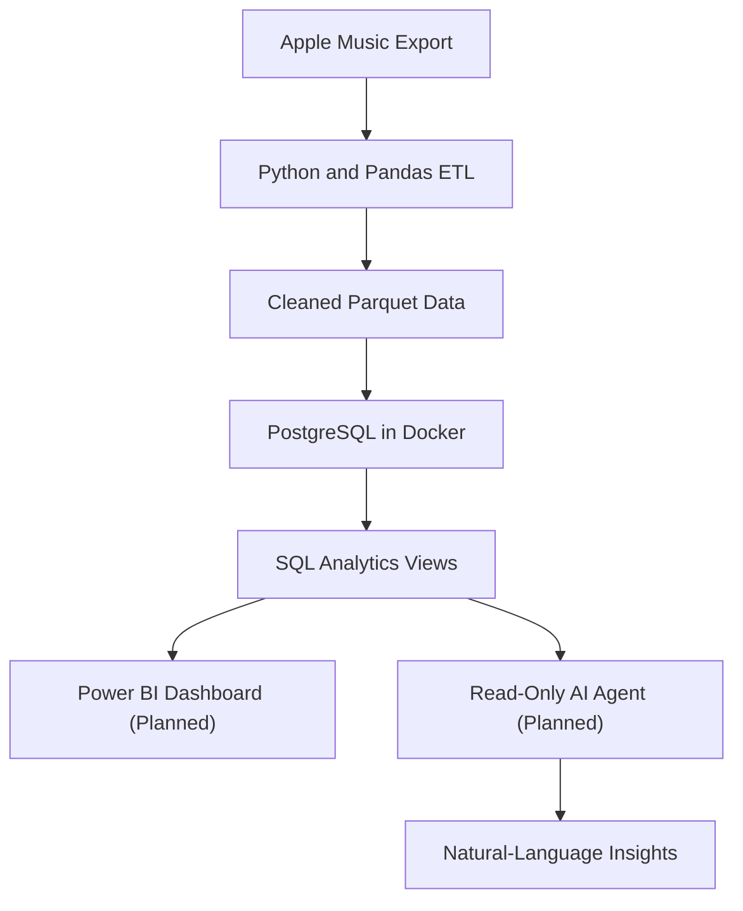

# Music Insights Agent

An end-to-end music analytics system that transforms private Apple Music listening history into cleaned data, a PostgreSQL analytics database, and verified SQL insights.

The current version includes the Python ETL pipeline, Dockerized PostgreSQL database, duplicate-safe loader, data-quality checks, and analytics views. The Power BI dashboard and read-only AI agent are the next stages.

## Project Goal

This project combines data engineering, business intelligence, and agentic AI to analyze music-listening behavior.

The completed data layer can answer questions such as:

- How did my listening change each month?
- Which tracks received the most listening time?
- How did my skip rate change?
- Which devices account for most of my listening?
- How do repeat and shuffle settings affect listening behavior?

The planned AI agent will answer these questions using verified results from approved SQL views.

## Architecture



## Current Data Results

The source Apple Music Play Activity export contains:

- 278,231 raw activity records
- 145 source columns
- Playback timestamps
- Song and album information
- Listening-duration fields
- Completion and skip information
- Device and playback-source data

The cleaned PostgreSQL dataset contains:

- 172,899 unique `PLAY_END` events
- 160,417 events that qualify for listening analytics
- 26 selected analytics columns
- Zero missing Event IDs
- Zero duplicate Event IDs
- Data from July 2023 through August 2026

Duration-quality results:

- 164,311 valid durations, or 95.03%
- 5,972 missing durations caused mainly by negative scrub activity
- 2,616 durations longer than the source media duration

## Data Engineering Decisions

### Listening-event grain

One database row represents one unique Apple Music `PLAY_END` event.

`PLAY_START` and `LYRIC_DISPLAY` events are excluded from the main listening table because they do not represent completed playback sessions.

### Primary key

`event_id` is the primary key because it uniquely identifies an Apple Music playback event.

The loader uses this key to prevent duplicates and safely process newer Apple Music exports.

### Duration handling

The pipeline uses the difference between the event start and end timestamps as the cleaned listening duration.

Rows with missing or unusual durations remain in the main table for auditing. The analytics view caps durations that exceed the media duration instead of deleting the original record.

### Staging and UPSERT loading

The PostgreSQL loader:

1. Validates the Parquet file.
2. Checks required columns and Event IDs.
3. Copies rows into a temporary staging table.
4. Compares staging rows with existing database rows.
5. Inserts new events.
6. Updates changed events.
7. Leaves identical events unchanged.
8. Records the result in `etl_runs`.

This makes the pipeline safe to rerun.

## Technology Stack

- Python
- Pandas
- PyArrow and Parquet
- PostgreSQL 17
- SQL
- Docker and Docker Compose
- Psycopg
- Power BI
- Git and GitHub

## Repository Structure

```text
music-insights-agent/
├── data/
│   ├── raw/                         Private Apple Music files
│   └── processed/                   Private cleaned Parquet files
├── docs/
│   ├── data-model.md
│   └── engineering-decisions.md
├── sql/
│   ├── schema.sql
│   ├── data_quality_checks.sql
│   └── analytics_views.sql
├── src/
│   ├── profile_data.py
│   ├── analyze_event_types.py
│   ├── analyze_play_end.py
│   ├── analyze_duration_fields.py
│   ├── clean_listening_events.py
│   ├── check_database.py
│   └── load_postgres.py
├── .env.example
├── compose.yaml
├── requirements.txt
└── README.md
```

## Run the PostgreSQL Data Layer

### 1. Create and activate a Python environment

```bash
python3 -m venv .venv
source .venv/bin/activate
```

### 2. Install the Python packages

```bash
python -m pip install -r requirements.txt
```

### 3. Create the local database configuration

```bash
cp .env.example .env
```

The `.env` file contains local database settings and is ignored by Git.

### 4. Start PostgreSQL

Make sure Docker Desktop is running, then execute:

```bash
docker compose up -d postgres
```

Check the container:

```bash
docker compose ps
```

The container should report a `healthy` status.

### 5. Prepare the private source data

Place the Apple Music Play Activity export at:

```text
data/raw/Apple Music Play Activity.csv
```

Run the cleaning pipeline:

```bash
python src/clean_listening_events.py
```

The cleaned output is written to:

```text
data/processed/listening_events.parquet
```

### 6. Create the PostgreSQL schema

```bash
docker compose exec -T postgres \
  psql -U music_user -d music_insights \
  < sql/schema.sql
```

### 7. Test the Python connection

```bash
python src/check_database.py
```

### 8. Load the cleaned data

```bash
python src/load_postgres.py
```

### 9. Run the data-quality checks

```bash
docker compose exec -T postgres \
  psql -U music_user -d music_insights \
  < sql/data_quality_checks.sql
```

### 10. Create the analytics views

```bash
docker compose exec -T postgres \
  psql -U music_user -d music_insights \
  < sql/analytics_views.sql
```

### 11. Query the analytics layer

Monthly listening:

```bash
docker compose exec postgres \
  psql -U music_user -d music_insights \
  -c "SELECT * FROM analytics.monthly_listening ORDER BY listening_month DESC LIMIT 12;"
```

Top tracks:

```bash
docker compose exec postgres \
  psql -U music_user -d music_insights \
  -c "SELECT * FROM analytics.track_summary ORDER BY listening_minutes DESC LIMIT 10;"
```

Device usage:

```bash
docker compose exec postgres \
  psql -U music_user -d music_insights \
  -c "SELECT * FROM analytics.device_summary ORDER BY listening_minutes DESC;"
```

### 12. Stop PostgreSQL

```bash
docker compose stop postgres
```

The named Docker volume preserves the database when the container stops.

## Analytics Views

The `analytics` schema currently contains:

- `valid_listening_events`: reporting-ready listening events
- `monthly_listening`: monthly listening, track, skip, and completion metrics
- `track_summary`: track-level listening and skip metrics
- `device_summary`: device-level listening and skip metrics

## Planned AI Safety Design

The planned AI agent will use these controls:

- Read-only PostgreSQL access
- Approved query tools
- Parameterized SQL templates
- Predefined analytics views
- Numerical evidence before explanations
- No unsupported claims about personal motivations

The agent can explain what changed in the data. It cannot claim to know why something changed outside the dataset.

## Project Status

- [x] GitHub repository created
- [x] Private data protected with `.gitignore`
- [x] Chunked data-profiling pipeline
- [x] Data cleaning and Parquet transformation
- [x] PostgreSQL database running in Docker
- [x] Staging-table and UPSERT loading pipeline
- [x] ETL run auditing
- [x] SQL data-quality checks
- [x] Reusable analytics views
- [ ] Power BI dashboard
- [ ] Read-only AI analytics agent
- [ ] Automated tests

## Privacy

The original Apple Music ZIP archive, CSV files, cleaned Parquet files, and local environment settings are never uploaded to GitHub.

The repository contains only:

- Source code
- SQL scripts
- Documentation
- Dashboard screenshots
- Sanitized sample data when available

## Disclaimer

This is an independent portfolio project and is not affiliated with or endorsed by Apple.