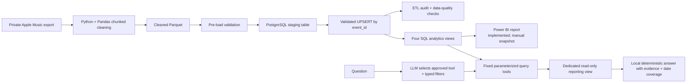

# Music Insights Agent

An end-to-end data engineering and analytics project that turns a private Apple Music export into a validated PostgreSQL dataset, reusable SQL analytics, a Power BI report, and a read-only terminal AI agent. It demonstrates Python, Pandas, Parquet, PostgreSQL, SQL, Docker, ETL validation, Power BI, and constrained LLM tool use.

[](https://github.com/Mohamed254-pixel/music-insights-agent/actions/workflows/tests.yml)

## Project highlights

- Processed **278,231 source records** and loaded **172,899 unique `PLAY_END` events** into PostgreSQL; **160,417** qualify for listening analytics.
- Uses chunked Pandas cleaning, Parquet, a PostgreSQL staging table, validation, and duplicate-safe UPSERTs.
- Provides **four analytics views** for valid events, monthly listening, track summaries, and device summaries.
- Includes a saved **three-page Power BI report** and a terminal AI agent with four approved analytics tools.
- Recorded full-export verification passed **47 regression tests**; the 24-case live LLM routing suite passed twice (**48/48 checks**) on October 26, 2026.

Numbers and test outcomes above are recorded verification results, not a claim that a private local database is connected to this public repository. See the dated [pipeline verification](docs/verification.md), [Power BI verification](powerbi/verification.md), and [agent evaluation record](docs/milestone-5-agent.md).

## Evidence and results

The Power BI report is a real saved project under [`powerbi/`](powerbi/README.md). Its browser screenshots and listening-level details are private and are not checked into this repository. The tables below provide reviewable, aggregated evidence from the recorded runs without exposing song titles or raw listening history.

### PostgreSQL pipeline and quality

| Recorded check | Verified result |
| --- | ---: |
| Raw Apple Music activity records read | 278,231 |
| Unique `PLAY_END` rows loaded | 172,899 |
| Missing / duplicate event IDs after cleaning and load | 0 / 0 |
| Eligible listening events | 160,417 |
| Valid listening durations | 164,311 (95.03%) |
| Missing or invalid durations retained for audit | 5,972 |
| Durations longer than source media | 2,616 |
| Second identical load: inserted / updated / unchanged | 0 / 0 / 172,899 |
| SQL totals compared with Pandas | Exact match for event count and capped duration |

### SQL analytics

A recorded read-only query over the analytics view returned the following all-time aggregates. Dates cover July 2023 through August 2026 in the imported snapshot.

| SQL result | Value |
| --- | ---: |
| Eligible listening events | 160,417 |
| Capped listening duration | 3,472.07 hours |
| Count-weighted skip rate | 19.35% |
| Eligible events with no timestamp | 56,679 (35.33%) |
| Timestamp coverage | 64.67% |

The SQL views support monthly listening, track/album summaries, device usage, skip counts, and duration metrics. A sample reproducible query:

```sql
SELECT
    COUNT(*) AS listening_events,
    ROUND(SUM(analytics_listening_duration_ms) / 3600000.0, 2) AS listening_hours,
    COUNT(*) FILTER (WHERE is_skipped) AS skipped_events,
    ROUND(
        COUNT(*) FILTER (WHERE is_skipped) * 100.0 / NULLIF(COUNT(*), 0),
        2
    ) AS skip_rate_percent
FROM analytics.valid_listening_events;
```

This query output is the dated aggregate recorded above; rerun it against your own local database to reproduce it. The private report’s verified pages are Listening Overview (13 visuals), Track Explorer (6), and Devices & Data Coverage (10). The semantic model has 16 measures. Its uploaded snapshot is manual and does not refresh automatically after database loads.

### Automated tests and agent evaluations

- GitHub Actions is configured for pushes and pull requests. Its [latest run on `main`](https://github.com/Mohamed254-pixel/music-insights-agent/actions/runs/40440963119) completed successfully at commit `49ee299`.
- Full-export verification on October 26, 2026: **47 tests passed**, including PostgreSQL permission checks and private-export ETL/Pandas reconciliation.
- This documentation-branch check on November 18, 2026: **47 tests discovered, 46 passed, 1 skipped** because the private Apple Music export is not in the clone. PostgreSQL integration tests ran against a disposable PostgreSQL 17 container.
- The live LLM evaluation used synthetic records: **24 cases run twice, 48/48 checks passed** on October 26, 2026.
- A separate real-data verification passed **8/8 questions** against read-only SQL on October 24, 2026. Its result details stay local.
- Power BI metadata validation passed for 3 pages, 32 local project visuals, and 41 schema-checked files. The saved web report has 29 visuals; these are two distinct artifacts.

The LLM results measure a finite set of routing and evidence cases, not universal answer accuracy. The GitHub workflow runs the automated test suite and Power BI schema validation; it does not access private listening data or call the live LLM. The latest existing `main` workflow completed successfully at commit `49ee299`; this documentation branch will trigger a new workflow when pushed.

## Architecture



The LLM does not write SQL or receive database rows or query results. SQL access is implemented through fixed application-owned templates and a dedicated restricted PostgreSQL login. The web chat interface and automatic Power BI refresh are not implemented.

## Tech stack

Python 3.13 · Pandas · PyArrow/Parquet · PostgreSQL 17 · SQL · Docker Compose · Psycopg · Power BI · OpenAI Responses API · GitHub Actions

## Data pipeline workflow

1. Read selected columns from the Apple Music CSV in 10,000-row chunks.
2. Keep `PLAY_END` events, normalize fields and timestamps, derive listening duration from start/end timestamps, and classify skips and natural endings.
3. Remove blank and duplicate event IDs while processing chunks; write the cleaned dataset to Parquet.
4. Validate required columns, event IDs, uniqueness, and event type before database loading.
5. Copy records into a temporary PostgreSQL staging table, compare staging and target counts, then insert new or update changed rows by `event_id`. Identical reruns leave rows unchanged.
6. Record load counts in `etl_runs`; use SQL checks and analytics views for downstream reporting.

## Data validation and quality

The cleaner preserves rows with missing or unusual duration values for audit. Analytics exclude non-positive or missing listening durations and cap durations to media length where available. Invalid or missing source timestamps are not fabricated. `event_id` is the primary key, and the loader rejects missing IDs, duplicate IDs, or rows that are not `PLAY_END` before loading.

The detailed [data model](docs/data-model.md), [engineering decisions](docs/engineering-decisions.md), and [verification record](docs/verification.md) describe data grain, validation behavior, loader accounting, and reproducible checks.

## SQL analytics views

The `analytics` schema contains:

- `valid_listening_events` — valid positive-duration events with duration capped to media length where applicable.
- `monthly_listening` — dated monthly counts, unique tracks, listening minutes, skips, skip rate, and natural-end metrics.
- `track_summary` — song/album event totals, capped listening minutes, completion, skips, and last-listened timestamp.
- `device_summary` — device event totals, capped listening minutes, skips, and first/last timestamps.

See [`sql/analytics_views.sql`](sql/analytics_views.sql) and [`sql/data_quality_checks.sql`](sql/data_quality_checks.sql) for implementation and audit queries.

## AI agent capabilities and limitations

The terminal agent supports top tracks ranked by listening hours or event count, monthly listening, device usage, and count-weighted skip rates. It can accept bounded date/device filters and asks for clarification or refuses requests outside the supported tool contract.

The model selects one approved function and typed arguments. Python validates them, then executes fixed parameterized SQL against `agent_analytics.listening_events` under a dedicated SELECT-only login and read-only transaction. SQL text is never model-generated. Query results remain local; a deterministic renderer returns the metrics and coverage explanation.

The agent does not support arbitrary SQL, writes, artists, custom track filters, causal explanations, multiple operations in one question, or a web interface. Date-bounded queries exclude undated events; their true dates cannot be inferred. Monthly results do not fill absent months with zeros. See the [Milestone 5 implementation and security boundaries](docs/milestone-5-agent.md). These controls reduce risk but do not establish production readiness or guarantee the model interprets every question correctly.

## Testing and evaluation

Install development dependencies and run the regression suite:

```bash
python -m pip install -r requirements-dev.txt
python -m unittest discover -s tests -t . -v
python powerbi/validate_project.py --schemas
python -m evals.run_agent
```

PostgreSQL tests require a disposable PostgreSQL 17 instance and `TEST_DATABASE_URL`; the suite creates and removes a temporary database. To reproduce full-export ETL reconciliation locally, also set `MUSIC_SOURCE_CSV` to your private export path. That optional test reads the file but does not commit it. For the optional live LLM run, configure `OPENAI_API_KEY` and `OPENAI_MODEL`, then use `python -m evals.run_agent --live --repeat 2`; it uses synthetic cases and incurs API usage. Full commands and dates are in [agent verification](docs/milestone-5-agent.md).

## Local setup

1. Create an environment and install runtime dependencies:

   ```bash
   python3 -m venv .venv
   source .venv/bin/activate
   python -m pip install -r requirements.txt
   cp .env.example .env
   ```

2. Start PostgreSQL and prepare the project schema:

   ```bash
   docker compose up -d postgres
   docker compose exec -T postgres psql -U music_user -d music_insights < sql/schema.sql
   ```

3. Put your own Apple Music export at `data/raw/Apple Music Play Activity.csv`, then run:

   ```bash
   python src/clean_listening_events.py
   docker compose exec -T postgres psql -U music_user -d music_insights < sql/analytics_views.sql
   python src/load_postgres.py
   docker compose exec -T postgres psql -U music_user -d music_insights < sql/data_quality_checks.sql
   ```

4. For the agent, provision a dedicated read-only login as documented in [Milestone 5 setup](docs/milestone-5-agent.md), configure `AGENT_DATABASE_URL`, `OPENAI_API_KEY`, and `OPENAI_MODEL` in your ignored local environment, and run:

   ```bash
   python -m src.agent.cli
   ```

Keep existing `.env` settings and credentials private. The saved Power BI report and native project setup are described in [`powerbi/README.md`](powerbi/README.md).

## Privacy and data limitations

Apple Music exports contain private listening history. Source exports, processed data, credentials, and Power BI data caches are excluded by `.gitignore`; do not add them to issues, screenshots, fixtures, or commits. Public examples use aggregate counts and do not list song titles or raw events.

The imported snapshot contains 56,679 eligible events without timestamps, so only 64.67% of eligible events have date coverage. Date-based totals are therefore partial. The current imported range ends in August 2026; later periods can correctly return no data. Power BI reflects a manually uploaded snapshot, not automatic database refresh. The separate native Desktop report still needs refresh verification in Windows Power BI Desktop.

## Future improvements

- Verify refresh and rendering in Windows Power BI Desktop.
- Define and test a repeatable refresh process for the online Power BI snapshot.
- Expand agent evaluations for new phrasings and failure cases while preserving the fixed tool boundary.
- Consider a web question interface after access control and deployment requirements are defined.
